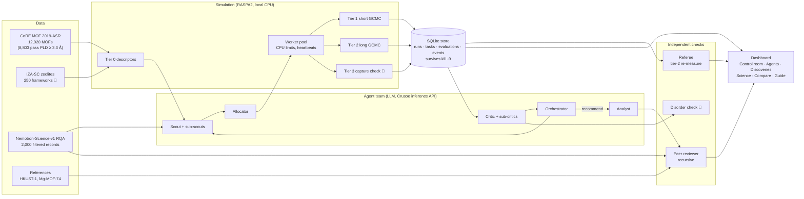
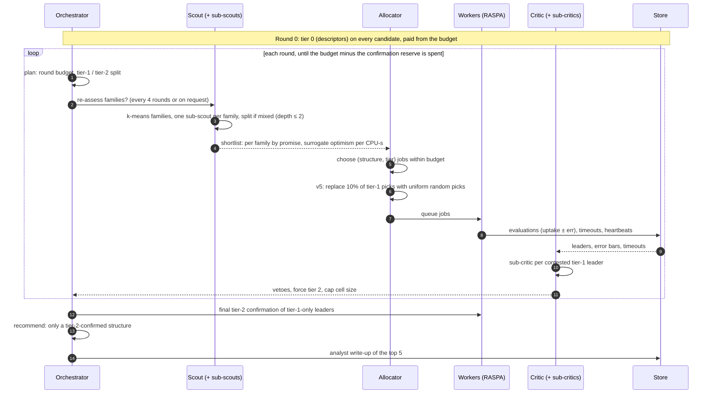
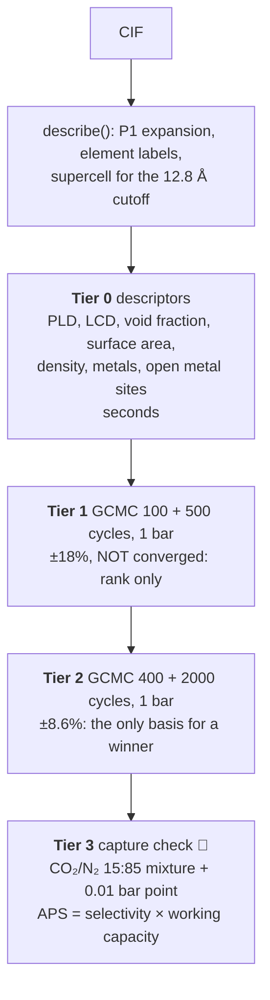
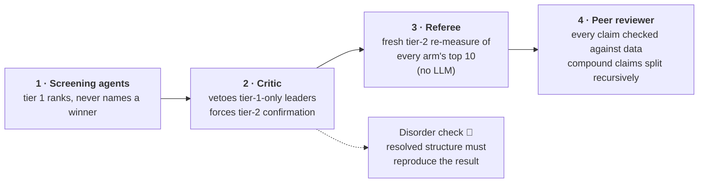
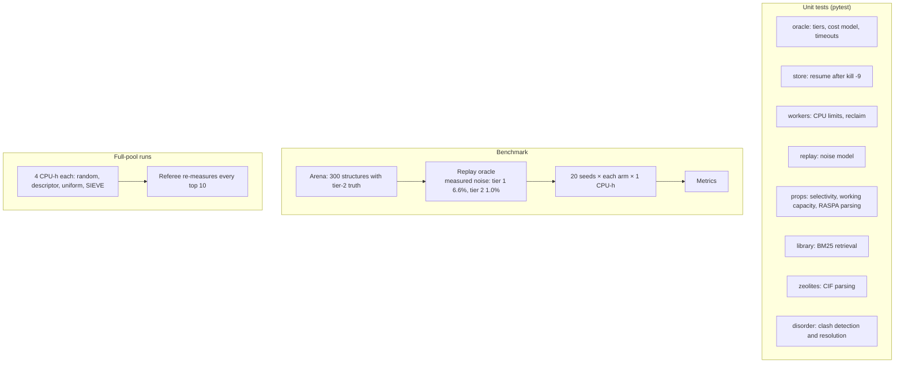

# SIEVE at a glance

SIEVE screens porous materials for CO₂ capture with grand-canonical Monte Carlo (GCMC) under a
fixed CPU budget. A team of LLM agents decides **what** to simulate and **how carefully**, and
independent checks decide whether to **believe** the result. This page maps every part: the
agents, their models, the simulation methods, the data, and how it is all tested.

Status markers: ✅ built and in use · 🧪 built, being benchmarked · 🚧 being built now.

---

## 1. The whole system



---

## 2. One screening run, round by round



Phases: **explore** (tier 1 only, until 70% of the budget is spent) → **confirm** (tier 2 on
leaders) → **capture check** (tier 3 on confirmed leaders, under the capture objective 🚧).
Rounds are pipelined: the next round is planned once the queue is empty and only the slowest
third of the workers are still running.

---

## 3. Agents and their models

All models run through the Crusoe inference API (OpenAI-compatible). No LLM ever sees a
ground-truth label. Every call is logged per role with its tokens, cost, latency and reasoning.

| Agent | Job | Model (default arm) | Delegates to |
|---|---|---|---|
| **Orchestrator** | owns the budget; plans each round; names the winner | Nemotron-3-Super-120B-A12B | Scout, Allocator, Critic, Analyst |
| **Scout** | splits the pool into material families; sets search rules; rates promise | Nemotron-3-Nano-30B-A3B | **sub-scouts**, one per family, which may split again (depth ≤ 2) |
| **Allocator** | picks each round's (structure, tier) jobs within the budget | Nemotron-3-Super-120B | (none) |
| **Critic** | audits the ranking; vetoes unconfirmed winners; caps giant cells | Nemotron-3-Super-120B | **sub-critics**, one per contested leader (Nano) |
| **Analyst** | explains why the top structures adsorb CO₂ | Nemotron-3-Super-120B | (none) |
| **Peer reviewer** | checks every claim against the simulation data | Nemotron-3-Super-120B (lead and sub-reviewers) | **sub-reviewers**, one per claim, then **sub-sub-reviewers** per part of a compound claim |

Variant arms used in the benchmark:

| Arm | What changes |
|---|---|
| `sieve` (v3) | earlier policy |
| `sieve-v4` | families, delegation, pipelined rounds |
| `sieve-v4-omni` | scout and sub-critics on Nemotron-3-Nano-Omni-Reasoning-30B-A3B |
| `sieve-dsv4` | orchestrator, allocator and critic on DeepSeek-V4-Pro |
| `sieve-v5` 🧪 | v4 plus upside-based family promise and a 10% uniform random slice |

---

## 4. Simulation methods



| Item | Choice |
|---|---|
| Engine | RASPA2 2.0.4 (patched: short paths, MakeGrid fixes), run as CPU-limited child processes |
| Force field | **SieveUFF**: UFF Lennard-Jones framework + TraPPE CO₂, Lorentz–Berthelot mixing, 12.8 Å cutoff, shifted. **No framework charges.** |
| Mixtures | **SieveUFFMix**: the same plus TraPPE N₂ (selectivity runs only) |
| Speed-up | precomputed energy grids (0.3 Å) when they pay for themselves, otherwise direct |
| Cost model | CPU-s ∝ (cycles + init) × max(20, molecules); fitted on calibration runs |
| Fault tolerance | CPU-time limits (RLIMIT_CPU), wall-clock backstop, heartbeats, reclaim of dead workers; `python -m sieve resume` after kill -9 |
| Pore blocking 🚧 | unreachable pockets found by periodic flood fill of the probe-energy grid, then blocked in RASPA |
| Disorder check 🚧 | atoms closer than any real bond are flagged; a resolved copy is re-measured before a disordered structure can win |

**Science page (per structure, outside every budget):** probe-energy field and 3D binding
pockets; isotherm from 0.05 to 5 bar; CO₂/N₂ selectivity; working capacity for vacuum swing,
mixture and temperature swing; Widom heat of adsorption and Henry constant.

---

## 5. Data

| Dataset | Use | Size | License / source |
|---|---|---|---|
| **CoRE MOF 2019-ASR** | the screening pool and its descriptors | 12,020 structures; 8,803 after the PLD ≥ 3.3 Å filter | CoRE MOF database (Chung et al.) |
| **Arena** | benchmark pool with known answers | 300 structures; tier-2 "truth" for each | built here (`sieve.arena`) |
| **Nemotron-Science-v1, RQA split** | grounding for the scout and peer reviewer: worked adsorption and CO₂ problems, cited per claim | 2,000 of 52,179 records, filtered by relevance | NVIDIA, CC-BY-4.0; synthetic and LLM-written, so used as background reasoning, **never as evidence** |
| **IZA-SC zeolites** 🚧 | reference materials; mixed MOF + zeolite pool | 250 frameworks, pure silica | Baerlocher & McCusker, Database of Zeolite Structures (downloaded locally, not redistributed) |
| **RASPA bundled structures** | reference MOFs (HKUST-1, Mg-MOF-74) | 2 used | RASPA2 (MIT) |

---

## 6. How it is checked: four independent layers



The peer reviewer's own guards:
- Verdicts roll up in code: a claim is supported only if every part is, and refuted only if every part is.
- An electrostatics or open-metal-site claim can never be "supported", because the model has no charges.
- Nemotron-Science passages may make a mechanism plausible, but never prove a number.

---

## 7. How it is tested



**Benchmark metrics (pre-registered):**
1. Best true uptake found, against budget (0.25, 0.5 and 1 CPU-h).
2. Top-decile recall.
3. Recommended winner inside the true top-k (k = 1, 5, 10).
4. Reliability across seeds.

**Baselines with the same budget:**
- **Random:** shuffled pool, tier 1 on each.
- **Descriptor:** ranked by descriptors, tier 1.
- **Uniform:** shuffled pool, tier 2 on each.

**Honesty rules:** tier 1 is not converged; rank, don't predict; winners need tier 2; losses
are reported. Current standing: SIEVE does not yet beat random search in the arena, and on the
full pool a baseline found the highest-uptake structure (ZADREE). That structure is now under
a disorder check.

---

## 8. Code map

```
src/sieve/
  oracle.py          tiers, cost model, RASPA environment, describe(), simulate, replay oracle
  _raspa_job.py      RASPA child runner (makegrid, mc_direct, mc_grid, mc_mixture, widom, movie)
  forcefield.py      SieveUFF / SieveUFFMix
  store.py           SQLite store, resume
  workers.py         worker pool, CPU limits, heartbeats
  baselines.py       random / descriptor / uniform arms
  arena.py, arena_eval.py, evaluate.py, referee.py   benchmark and evaluation
  science.py         energy field, isotherm, capture metrics
  library.py         Nemotron-Science-v1 BM25 retrieval
  disorder.py        clash detection and resolution
  agents/            orchestrator, scout, allocator, critic, analyst, reviewer, llm, base, world
  dashboard/         FastAPI server and static pages
```

---

## 9. What we found, compared with standard capture materials

### The leads

| Structure | Found by | Uptake at 1 bar (referee, tier 2) | Clean crystal file? |
|---|---|---|---|
| **ZADREE** (Cu MOF) | random and uniform baselines | 9.41 ± 0.04 mol/kg | ⚠️ no: 32 N/O atom pairs 0.45 Å apart at the Cu sites |
| GANBAZ01 (Mn MOF) | descriptor baseline | 8.16 ± 0.05 | ⚠️ no: duplicated rings |
| WARFAY04 (Zn MOF) | random baseline | 8.16 ± 0.07 | ⚠️ no: duplicated hydrogens |
| **QIPROY** (Cu MOF) | **SIEVE** | 7.15 ± 0.06 | ✅ yes |

### Against the standards

Same model and protocol for every row in the first table (298 K, SieveUFF, no framework charges):

| Structure | 0.15 bar (flue gas) | 1 bar | CO₂/N₂ selectivity | Working capacity, temperature swing | Heat of adsorption |
|---|---|---|---|---|---|
| ZADREE | 6.97 | 9.41 | 74.5 | 5.54 | 42.4 kJ/mol |
| QIPROY | 1.48 | 7.15 | 22.0 | 1.33 | 25.0 kJ/mol |
| HKUST-1 | 0.56 | 1.80 | 13.3 | 0.48 | 26.5 kJ/mol |
| Mg-MOF-74 | 0.27 | 1.74 | 6.3 | 0.22 | 17.5 kJ/mol |
| typical pool MOF (CAXTEC) | 0.44 | 2.08 | 8.3 | 0.37 | 20.4 kJ/mol |

Uptakes and working capacities are in mol/kg.

Approximate literature values for orientation. These are **not** from this project; check them
against primary sources before citing:

| Material | Type | CO₂ at 0.15 bar | CO₂ at 1 bar | Binding strength | Weak point |
|---|---|---|---|---|---|
| MEA amine (30 wt%) | liquid, industrial standard | ~1 mol/kg cyclic capacity | (n/a) | ~85 kJ/mol (chemical) | regeneration energy, corrosion, degradation |
| Zeolite 13X | solid, commercial | ~2.5–3 | ~4.5–5 | ~40–50 kJ/mol | water ruins its performance |
| Mg-MOF-74 | best-known MOF | ~5–6 | ~8 | ~40–47 kJ/mol | water-sensitive, costly |
| HKUST-1 | common MOF | ~0.5–1 | ~4 | ~25–30 kJ/mol | moderate everywhere |

### How to read this

**On paper, ZADREE beats the standards.** It holds about 7 mol/kg at flue-gas pressure against
~1 for MEA and ~3 for 13X. Its binding strength (42 kJ/mol) sits in the useful range: strong
enough to hold CO₂, roughly half of an amine's chemical bond, so it should be cheaper to
regenerate.

**We cannot yet trust that comparison:**

1. **The model is not the lab.** With no framework charges, the model puts Mg-MOF-74 at 1.7 mol/kg
   against ~8 in experiment. Comparing a simulated 9.4 with a measured 8 compares two different
   things. Only the same-model table above is a fair comparison.
2. **ZADREE's crystal file is disordered.** All 32 of its nitrogen atoms sit 0.45 Å from an oxygen
   atom: one site recorded both ways, kept twice. The doubled atoms line exactly the Cu pockets where
   CO₂ binds, and could explain its unusually deep −18.9 kJ/mol well. A corrected copy is being
   re-simulated now. The same applies to ranks 2 and 3.
3. **No pore blocking yet** (in progress). The model can fill pockets CO₂ cannot reach.
4. **Rigid frameworks, dry gas.** Real flue gas is humid, and water is what kills most MOFs and 13X
   in practice.
5. **It is a published compound** (CSD refcode ZADREE). Someone may already have measured it, so the
   CSD entry and its paper come first.

**What is interesting even with the caveats:**

- **Geometry alone:** ZADREE binds CO₂ 16× better than a typical pool structure at flue-gas
  pressure, with no electrostatics at all.
- **Charges might help further:** most strong sorbents rely on charged sites, so adding framework
  charges may raise its numbers further. That is an expectation, not a result.
- **The real risk is an artefact:** disorder and pore blocking are the main ways its result could
  be one.

**What would make it significant:**

1. Find its paper and any existing CO₂ measurements.
2. Re-simulate the disorder-resolved structure with pore blocking and with framework charges.
3. Check water stability.
4. Synthesise and measure it, which needs a lab.

### Why look beyond MEA and 13X at all

- **MEA works but is expensive to run.** Boiling the CO₂ back out of the amine solution can take
  about a quarter to a third of a power plant's output. That energy penalty is the main reason
  carbon capture is costly. The amine also degrades and corrodes equipment.
- **13X is cheap but needs dry gas.** Drying flue gas costs money and energy.
- **Solid sorbents could do better on both.** They could hold more CO₂ per kg and need less energy
  to release it. A modest gain over MEA is worth a great deal at power-plant scale, which is why
  thousands of MOFs are studied.

### Why SIEVE matters

**The bottleneck is search, not chemistry.** There are over 12,000 known MOF structures and
millions of hypothetical ones. Lab tests take weeks per material. Simulating every known structure
properly would take ~220 CPU-hours at the cheapest useful fidelity, and far more at confirmed
fidelity.

**What SIEVE did in 4 CPU-hours:**

- **Screen:** it described all 8,803 candidates at tier 0, ran GCMC on 115 of them and confirmed 10
  at tier 2.
- **Verify:** it named a winner, QIPROY, which survived the critic, the referee (7.23 claimed,
  7.15 re-measured), the peer reviewer and the disorder check.

**The honest scorecard:**

- **SIEVE did not find the highest-uptake structure.** The random and uniform baselines hit ZADREE
  through one lucky shuffle they share, at position 56 of 8,803.
- **On the 300-structure arena benchmark, SIEVE does not yet beat random search.**
- **The fixes are being measured:** v5 adds an upside-seeking promise and a random slice, and the
  disorder check is being wired into the critic. Both are being benchmarked.
- **But the disorder check changes what "best" means.** The three structures that beat SIEVE's pick
  all have broken crystal files, and QIPROY is the top result with a clean one.

**The contribution so far is the method:** a budgeted, fault-tolerant multi-agent screen whose
claims pass four independent checks. It finds problems in its own results, and in its baselines'.

**The output is a shortlist for chemists, not a material.**

- **ZADREE:** a lead that warrants steps 1–2 above.
- **QIPROY:** the best-supported candidate.

Neither is a discovery until a lab measures it.
